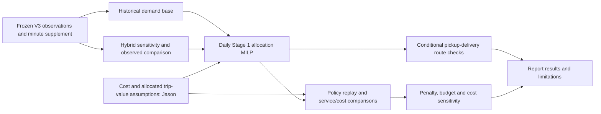

# Published project pipeline

**Exact-plan download:** [original ZIP, 187 CSVs, replay/cost checks and verification command](../output/sf_bikeshare/optimization_14days_2026-11-22/EXACT_PLAN_AUDIT_README.md). Use `python sf_bikeshare/check_exact_report_routing.py` for fixed-plan replay and supplied-certificate validation without re-solving allocation.

**Team's main reference:** this document on the repository's `main` branch is the current reference for the complete pipeline and its supplementary files. Older drafts, posters and experimental branches are historical context; keep future report and implementation changes consistent with the assumptions and scope recorded here. Outstanding gaps remain visible in the linked reviews.

Updated 22 November 2026. The team confirmed **historical demand as base**, **hybrid as sensitivity**, and **observed trips as a lower-demand comparison**. Both estimated-demand cases subtract trips already served during outages. Fu Yan's latest code reproduces the published outputs; the former missing-core handoff is resolved.

## Pipeline and owners



| Stage | Owner | Deliverable and status |
| --- | --- | --- |
| Introduction, motivation and literature review | Jason | Sections 1–2 of the supplied report; research context for the formulation and cost structure |
| Ingestion, cleaning and features | Carlo | Frozen V3, 34 SF stations, 70 days, metric units; minute supplement and audited opening stock |
| Demand estimation and reconstruction validation | Fu Yan, reviewed with Carlo | Complete producer; historical and hybrid station-hour CSVs, episode audits, rates and matched validation |
| Cost and allocated trip-value evidence | Jason | Sources and assumptions; executed report scenario distinguished from updated-cost extension |
| Time-expanded formulation | Joohee | 24-hour daily MILP, base contribution objective, return penalties and budget alternative |
| Implementation, rule baseline and replay | Hong Jin, Joohee | Model/evaluator code and completed 14-day historical/hybrid/observed comparisons |
| Penalty, budget and diversion experiments | Joohee | Completed supplied outputs, imported unchanged; descriptive diversion check |
| Routing extension and sensitivity interpretation | Hong Jin, Joohee | Exact historical transfer/state/route files now supplied and independently checked; all 133 active optimized hours pass conditionally at one-minute setup |
| Data/repository handoff and final consistency edit | Carlo | Published pipeline, checks, result links and manual report corrections |

The [handoff review](JOOHEE_HANDOFF_2026-11-22.md) describes Joohee's completed files. The [report reconciliation](REPORT_RECONCILIATION_2026-11-22.md) lists corrections before final submission. Google Docs remain untouched.

The [end-to-end review](PIPELINE_END_TO_END_REVIEW_2026-11-22.md) assesses objective alignment, remaining gaps and actions. The optimizer uses the full day's demand while the occupancy rule has no look-ahead, so their difference includes an information/planning advantage.

**Exact report evidence received:** [Joohee's original audit and independent verification](../output/sf_bikeshare/optimization_14days_2026-11-22/EXACT_PLAN_AUDIT_README.md) now close the missing-schedule gap. Her exact 766-bike plans pass all 133 active hours on nine truck days at one-minute setup; two-minute setup leaves 29 hours on three days uncertified. The rule passes 3/14 days at one minute. Carlo's earlier re-solve (8/9 active days) remains separate. Both are conditional checks, without depot, shift or minute-by-minute customer/inventory certification.

### Jason's contribution and where it enters

Jason owns the Introduction and Literature Review (report Sections 1–2), plus the pricing and cost evidence used in Section 3.3 and the model parameters. His contributions feed the formulation, economic objective and sensitivity analysis; they are not a separate demand-estimation stage.

- Trip allocations: member USD0.88 and casual USD4.50 in the base, with [low/base/high allocation assumptions](../output/sf_bikeshare/model_inputs_v3/revenue_allocation_scenarios.csv) and [historical tariff evidence](../output/sf_bikeshare/model_inputs_v3/tariff_reference.csv). The V3 tables retain their original dated scenario labels.
- Cost research: vehicle hire, rental mileage, fuel, loaded wage, handling and supporting references. The [dated input handoff](supporting/SF_Bikeshare_Model_Input_Handoff_2026-11-20.md) records the earlier evidence; the [updated-cost configuration](../sf_bikeshare/integration_cost_config.json) contains the later wage/source assumptions used in the separate extension.
- Executed report model: USD60/day, USD1/bike handling and the approximate USD0.30/km travel coefficient. These are the coefficients behind Joohee's supplied results. The later fully explicit driving-time formulation is a separate scenario, not silently substituted into those results.

The supplied initial report includes Sections 1–2 and 3.3. No separate Jason-authored report file was in Joohee's Drive upload; this repository publication provides the attributed pipeline and input evidence rather than claiming to have imported a separate Jason document.

## Inputs and fixed assumptions

| Item | Agreed implementation |
| --- | --- |
| Scope | 34 SF stations, 9 February to 19 April 2015; 57,120 station-hours |
| Training / evaluation | 9 February to 5 April / 6 to 19 April; evaluation dates were explored during development |
| Minute status | Carry the left snapshot to the next only for valid positive gaps of at most 90 seconds; longer gaps are unknown |
| Historical rates | Training available-period events divided by summed available exposure, by station, clock hour, weekday/weekend and rider; pool day types if exposure is insufficient; unsupported rates remain missing |
| Episode adjustment | Expected arrivals minus served events, clipped at zero once per episode, then allocated by expected hourly arrivals and added to observed counts |
| Hybrid | Preceding 30-minute rate with at least 20 available minutes for the first 60 elapsed minutes; historical rates afterwards or when predecessor support is inadequate |
| Validation | Fully valid/available hidden windows entirely in evaluation dates; same targets per method; actual unmet requests are unobserved |
| Opening inventory | Observed midnight stock; latest preceding snapshot selected before validity/freshness checks; no hourly reset to historical stocks |
| Capacity | station.csv dock_count; lower-capacity interpretation remains sensitivity rather than a silently changed base |
| Decisions | Integer transfers and truck count; continuous expected inventory/service; binary min/max linearization variables |
| Network | Five nearest directed destinations per origin: 170 transfer arcs, not every pair |
| Within-hour order | Transfers, then pickups, then fixed returns; same-hour arrivals; within-hour availability is approximate |
| Rider service | Proportional rider allocation within each station-hour; not event-level FCFS |
| Boundary / returns | Outside-bound pickups can be lost; attempted returns can fail at full docks; returns are not linked to accepted departures |
| Vehicle | One available truck, 15 bikes/hour throughput, average load 15; route capacity 25 is a separate assumption |
| Billing / end stock | USD60 per activated truck-day; no mandatory end-stock target in base |
| Trip values / penalty | Member USD0.88, casual USD4.50; allocations, not marginal receipts. Base failed-return penalty USD0.88 |
| DST | Recorded local-hour slots and flags retained; timestamps are not repaired |
| Route | Open start at first pickup, free initial approach, pickup-before-delivery, handling/setup and inter-hour position continuity; no depot, worker shift or event-level station-inventory certificate |

For episode e, rider r and affected hour t, with expected arrivals E and recorded served events S:

$$
M_{er}=\max(0,\sum_t E_{etr}-S_{er}),\qquad
\widehat D_{itr}=O_{itr}+\sum_e M_{er}\frac{E_{etr}}{\sum_{t'} E_{et'r}}.
$$

Zero expected totals allocate no additional demand; unsupported required rates are flagged rather than replaced by zero. Historical rates change with clock hours, even inside long episodes.

## Executed report cost versus updated-cost extension

The completed report runs retain:

$$
C_1=60y+\sum_{ijt}(1.00+0.30d_{ij}/15)x_{ijt}.
$$

Distance is road kilometres and money is USD. The USD0.30/km coefficient is an approximate scenario, not demonstrated complete driving-labour reimbursement. Handling is approximately one minute per load and one per unload at the adopted loaded wage. Average load, throughput and onboard capacity have separate meanings.

The exact report plans have also been repriced with the stated vehicle/wage proxies: productive-activity route cost is USD2,400.00 and additional contribution becomes -USD878.71; paid-span costing gives -USD4,191.83. These are verified conditional estimates for the exact fourteen-day case, holding hourly service fixed. See the [exact-plan cost audit](../output/sf_bikeshare/optimization_14days_2026-11-22/exact_plan_route_costs.csv).

The [updated-cost re-solve](INTEGRATION_REVIEW_2026-11-22.md) remains separate: its -USD703/-USD3,782 cover thirteen priced days of different allocations. Stage 1 and Stage 2 price the same operation; do not add them. Incomplete routes receive no invented full-day cost.

## Published datasets and results

- [Frozen V3](../output/sf_bikeshare/model_inputs_v3/README.md) and [minute supplement](../output/sf_bikeshare/demand_estimation_inputs_v3/README.md).
- [Historical base CSV](../output/sf_bikeshare/demand_estimation_cases_2026-11-22/historical_demand_station_hour.csv.gz) and [hybrid sensitivity CSV](../output/sf_bikeshare/demand_estimation_cases_2026-11-22/estimated_demand_station_hour_hybrid.csv.gz), both 57,120 rows x 31 columns. Pandas reads gzip directly.
- [Matched demand validation](../output/sf_bikeshare/demand_case_comparison_2026-11-22/matched_validation.csv).
- [Completed 14-day policy and cost results](../output/sf_bikeshare/optimization_14days_2026-11-22/README.md).
- [Completed penalty, budget and diversion outputs](../output/sf_bikeshare/extra_experiments_2026-11-22/README.md).
- [Separate updated-cost experiments](../output/sf_bikeshare/integration_review_2026-11-22/README.md).

The observed comparison supplies no outage correction; it is not a third fitted demand estimator. Each case uses the same observed station/distance/opening inputs. Historical adds 2,330.775 pickups and 688.136 returns; hybrid adds 4,346.924 and 1,326.521 over the 70-day observations.

## Run and verify

From the repository root:

```bash
python -m pip install -r requirements-integration.txt
python sf_bikeshare/run_project_pipeline.py
```

The default checks hashes, schemas, demand totals, supplied accounting and recorded solver/replay diagnostics. **It does not rerun experiments or overwrite published files.** The supplied completed results are already downloadable.

Only when an explicit rebuild is wanted:

```bash
python sf_bikeshare/run_project_pipeline.py --build-demand --output-dir tmp/rebuild_demand
python sf_bikeshare/run_project_pipeline.py --build-demand --run-models --output-dir tmp/rebuild_models
python sf_bikeshare/run_project_pipeline.py --run-extra-experiments --output-dir tmp/rebuild_extras
```

Use a new/empty destination. Published output folders are protected. Model rebuilds run the three policies for historical, hybrid and observed demand on all 14 dates, with route checks and fixed-schedule cost repricing. Extra rebuilds run the documented 14-day penalty/budget experiments. Finite-time MIP incumbents can vary; inspect statuses, gaps and replay errors rather than expecting identical dispatches. The diversion output remains the supplied result; its original script writes its fixed output path and should not be run casually over published files.

Demand-only and integration-invariant tests remain available as documented in [the methods guide](INTEGRATION_METHODS_2026-11-22.md). Full raw-source ingestion is documented in the [V3 handoff](../output/sf_bikeshare/model_inputs_v3/README.md); the raw databases are intentionally local.

## Robustness scope and report completion

Demand scenarios, cost repricing, selected cost/throughput reoptimizations, penalties and budget experiments are completed. The [five additional city/time packages](../output/sf_bikeshare/robustness_testing/README.md) are prepared observations only. They have not been passed through demand estimation and policy optimization here; their scope/availability inputs and missing-opening rules require separate handling.

The supplied final PDF v2 corrects the penalty row, cost-scenario percentages, proportional-service wording and major diversion/routing qualifications. Exact schedules and costs are now independently verified. The [v2 review](FINAL_REPORT_V2_REVIEW_2026-11-22.md) identifies four final interpretation edits: finite-gap gains, route-level ranking, joint cost/service dependence and benefit-bias inference. Lectures support the flow, integer and conditional route/scenario methods; they do not prove estimator truth or operational profit. See [lecture alignment](INTEGRATION_METHODS_2026-11-22.md#mathematical-model-and-lecture-alignment).

The earlier pipeline PDF and poster are dated planning artifacts; this Markdown pipeline is the current implementation reference.
