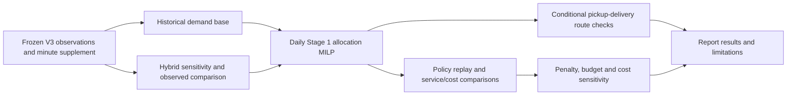

# Published project pipeline

Updated 22 November 2026. The team confirmed **historical demand as base**, **hybrid as sensitivity**, and **observed trips as a lower-demand comparison**. Both estimated-demand cases subtract trips already served during outages. Fu Yan's latest code reproduces the published outputs; the former missing-core handoff is resolved.

## Pipeline and owners



| Stage | Owner | Deliverable and status |
| --- | --- | --- |
| Ingestion, cleaning and features | Carlo | Frozen V3, 34 SF stations, 70 days, metric units; minute supplement and audited opening stock |
| Demand estimation and reconstruction validation | Fu Yan, reviewed with Carlo | Complete producer; historical and hybrid station-hour CSVs, episode audits, rates and matched validation |
| Cost and allocated trip-value evidence | Jason | Sources and assumptions; executed report scenario distinguished from updated-cost extension |
| Time-expanded formulation | Joohee | 24-hour daily MILP, base contribution objective, return penalties and budget alternative |
| Implementation, rule baseline and replay | Hong Jin, Joohee | Model/evaluator code and completed 14-day historical/hybrid/observed comparisons |
| Penalty, budget and diversion experiments | Joohee | Completed supplied outputs, imported unchanged; descriptive diversion check |
| Routing extension and sensitivity interpretation | Hong Jin, Joohee | Conditional route checker available; exact report-schedule audit files were not in the handoff |
| Data/repository handoff and final consistency edit | Carlo | Published pipeline, checks, result links and manual report corrections |

The [handoff review](JOOHEE_HANDOFF_2026-11-22.md) describes Joohee's completed files. The [report reconciliation](REPORT_RECONCILIATION_2026-11-22.md) lists corrections before final submission. Google Docs remain untouched.

## Inputs and fixed assumptions

| Item | Agreed implementation |
| --- | --- |
| Scope | 34 SF stations, 9 February?19 April 2015; 57,120 station-hours |
| Training / evaluation | 9 February?5 April / 6?19 April; evaluation dates were explored during development |
| Minute status | Carry the left snapshot to the next only for valid positive gaps of at most 90 seconds; longer gaps are unknown |
| Historical rates | Training available-period events divided by summed available exposure, by station, clock hour, weekday/weekend and rider; pool day types if exposure is insufficient; unsupported rates remain missing |
| Episode adjustment | Expected arrivals minus served events, clipped at zero once per episode, then allocated by expected hourly arrivals and added to observed counts |
| Hybrid | Preceding 30-minute rate with at least 20 available minutes for the first 60 elapsed minutes; historical rates afterwards or when predecessor support is inadequate |
| Validation | Fully valid/available hidden windows entirely in evaluation dates; same targets per method; actual unmet requests are unobserved |
| Opening inventory | Observed midnight stock; latest preceding snapshot selected before validity/freshness checks; no hourly reset to historical stocks |
| Capacity | station.csv dock_count; lower-capacity interpretation remains sensitivity rather than a silently changed base |
| Decisions | Integer transfers and truck count; continuous expected inventory/service; binary min/max linearization variables |
| Network | Five nearest directed destinations per origin: 170 transfer arcs, not every pair |
| Within-hour order | Transfers, then pickups, then fixed returns; same-hour arrivals; within-hour availability is approximate |
| Rider service | Proportional rider allocation within each station-hour; not event-level FCFS |
| Boundary / returns | Outside-bound pickups can be lost; attempted returns can fail at full docks; returns are not linked to accepted departures |
| Vehicle | One available truck, 15 bikes/hour throughput, average load 15; route capacity 25 is a separate assumption |
| Billing / end stock | USD60 per activated truck-day; no mandatory end-stock target in base |
| Trip values / penalty | Member USD0.88, casual USD4.50; allocations, not marginal receipts. Base failed-return penalty USD0.88 |
| DST | Recorded local-hour slots and flags retained; timestamps are not repaired |
| Route | Open start at first pickup, free initial approach, pickup-before-delivery, handling/setup and inter-hour position continuity; no depot, worker shift or event-level station-inventory certificate |

For episode e, rider r and affected hour t, with expected arrivals E and recorded served events S:

$$
M_{er}=\max(0,\sum_t E_{etr}-S_{er}),\qquad
\widehat D_{itr}=O_{itr}+\sum_e M_{er}\frac{E_{etr}}{\sum_{t'} E_{et'r}}.
$$

Zero expected totals allocate no additional demand; unsupported required rates are flagged rather than replaced by zero. Historical rates change with clock hours, even inside long episodes.

## Executed report cost versus updated-cost extension

The completed report runs retain:

$$
C_1=60y+\sum_{ijt}(1.00+0.30d_{ij}/15)x_{ijt}.
$$

Distance is road kilometres and money is USD. The USD0.30/km coefficient is an approximate scenario, not demonstrated complete driving-labour reimbursement. Handling is approximately one minute per load and one per unload at the adopted loaded wage. Average load, throughput and onboard capacity have separate meanings.

The separate [updated-cost configuration](../sf_bikeshare/integration_cost_config.json) uses USD0.985667/bike handling plus pair-specific vehicle and driving-time labour. Its [executed results](INTEGRATION_REVIEW_2026-11-22.md) are a separate extension and must not be substituted for the report's USD202 result. Stage 2 reprices the same redistribution operation; never add Stage 1 and Stage 2 as two expenses. An incomplete route receives no invented full-day route cost.

## Published datasets and results

- [Frozen V3](../output/sf_bikeshare/model_inputs_v3/README.md) and [minute supplement](../output/sf_bikeshare/demand_estimation_inputs_v3/README.md).
- [Historical base CSV](../output/sf_bikeshare/demand_estimation_cases_2026-11-22/historical_demand_station_hour.csv.gz) and [hybrid sensitivity CSV](../output/sf_bikeshare/demand_estimation_cases_2026-11-22/estimated_demand_station_hour_hybrid.csv.gz), both 57,120 ? 31. Pandas reads gzip directly.
- [Matched demand validation](../output/sf_bikeshare/demand_case_comparison_2026-11-22/matched_validation.csv).
- [Completed 14-day policy and cost results](../output/sf_bikeshare/optimization_14days_2026-11-22/README.md).
- [Completed penalty, budget and diversion outputs](../output/sf_bikeshare/extra_experiments_2026-11-22/README.md).
- [Separate updated-cost experiments](../output/sf_bikeshare/integration_review_2026-11-22/README.md).

The observed comparison supplies no outage correction; it is not a third fitted demand estimator. Each case uses the same observed station/distance/opening inputs. Historical adds 2,330.775 pickups and 688.136 returns; hybrid adds 4,346.924 and 1,326.521 over the 70-day observations.

## Run and verify

From the repository root:

```bash
python -m pip install -r requirements-integration.txt
python sf_bikeshare/run_project_pipeline.py
```

The default checks hashes, schemas, demand totals, supplied accounting and recorded solver/replay diagnostics. **It does not rerun experiments or overwrite published files.** The supplied completed results are already downloadable.

Only when an explicit rebuild is wanted:

```bash
python sf_bikeshare/run_project_pipeline.py --build-demand --output-dir tmp/rebuild_demand
python sf_bikeshare/run_project_pipeline.py --build-demand --run-models --output-dir tmp/rebuild_models
python sf_bikeshare/run_project_pipeline.py --run-extra-experiments --output-dir tmp/rebuild_extras
```

Use a new/empty destination. Published output folders are protected. Model rebuilds run the three policies for historical, hybrid and observed demand on all 14 dates, with route checks and fixed-schedule cost repricing. Extra rebuilds run the documented 14-day penalty/budget experiments. Finite-time MIP incumbents can vary; inspect statuses, gaps and replay errors rather than expecting identical dispatches. The diversion output remains the supplied result; its original script writes its fixed output path and should not be run casually over published files.

Demand-only and integration-invariant tests remain available as documented in [the methods guide](INTEGRATION_METHODS_2026-11-22.md). Full raw-source ingestion is documented in the [V3 handoff](../output/sf_bikeshare/model_inputs_v3/README.md); the raw databases are intentionally local.

## Robustness scope and report completion

Demand scenarios, cost repricing, selected cost/throughput reoptimizations, penalties and budget experiments are completed. The [five additional city/time packages](../output/sf_bikeshare/robustness_testing/README.md) are prepared observations only. They have not been passed through demand estimation and policy optimization here; their scope/availability inputs and missing-opening rules require separate handling.

The current draft's main numerical results match the supplied historical case. Final editing must reconcile the USD0.50-penalty row, cost-scenario percentages, route evidence and the interpretation of proportional service, demand bias and diversion. Lectures support the time-expanded flow, mixed-integer constraints, conditional DP route search and scenario re-solving; they do not prove estimator truth or real operational profit. See [lecture alignment](INTEGRATION_METHODS_2026-11-22.md#mathematical-model-and-lecture-alignment).

The earlier pipeline PDF and poster are dated planning artifacts; this Markdown pipeline is the current implementation reference.
