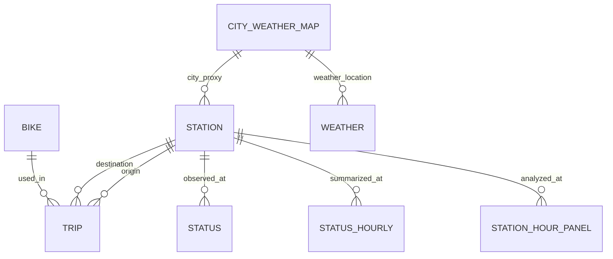

# Tables, keys and relationships

The builder creates a local DuckDB database at `output/sf_bikeshare/sf_bikeshare.duckdb`. The source CSVs remain in their original folder and are never overwritten. The 2 GB status CSV is scanned in full; there is no status sampling in this analysis.

## Grains and logical keys

| Table | One row represents | Key | Relationships |
| --- | --- | --- | --- |
| station | A station's supplied static record | station_id | Referenced by both trip endpoints and status |
| bike | An observed bicycle identifier | bike_id | Referenced by trip; no asset or repair history |
| trip | A completed trip | trip_id | start_station_id and end_station_id to station; bike_id to bike |
| status | One station snapshot | station_id + observed_at, subject to full key audit | station_id to station |
| weather | A weather location-day | weather_zip_code + weather_date | Linked through city mapping and date |
| city_weather_map | One analyst-assigned city weather proxy | city; weather_zip_code is unique | station.city to city; ZIP/date to weather |
| status_hourly | Availability exposure in a station-hour | station_id + hour_start | Derived from bounded intervals |
| station_hour_panel | One installation-eligible station-hour | station_id + hour_start | Trips, status and weather at a shared grain |

Small-table keys have unique indexes. The raw status key is audited in full without constructing an enormous raw-status primary-key index. Any repeated status keys are separately exported: identical copies may be collapsed for interval analysis; conflicting states are quarantined. Logical foreign keys are validated with anti-joins and reconciliation assertions, not declared as physical foreign-key constraints.

## Weather mapping

| City | Weather ZIP proxy |
| --- | --- |
| San Francisco | 94107 |
| Redwood City | 94063 |
| Palo Alto | 94301 |
| Mountain View | 94041 |
| San Jose | 95113 |

This is an analyst city-level proxy selected from the five available weather locations. Station has no ZIP field. It is not an exact station-to-weather distance match and should be checked before any fine-grained weather analysis. `trip.rider_zip_code` is retained as text; it is not a station geography key, customer ID or revenue-account identifier.

## Safe join patterns

1. Join trip's two station IDs to station separately, with explicit origin/destination aliases.
2. Aggregate completed departures by start time and arrivals by end time to station-hour.
3. Aggregate valid availability intervals to the same station-hour, summing observed/empty/full seconds.
4. Join facts using both station_id and hour_start. Never station_id alone.
5. Join station city to the explicit mapping and weather using weather ZIP plus date.
6. Confirm that joined trip totals, observation exposure and row counts reconcile.

At minute precision, use a correctly bounded as-of join rather than a direct equality between trip timestamps and status timestamps with seconds. Timezone metadata and daylight-saving ambiguity are not resolved by the supplied timestamps. The primary analysis uses recorded local clock time and treats nonpositive or long next-snapshot intervals as unknown rather than creating an artificial transition.

## Time exposure

For two consecutive station observations at `t` and `t_next`, carry the state at `t` over `[t,t_next)` only when `0 < t_next - t <= 90 seconds` and the state has nonnegative counts and a positive total. Split at hour boundaries. Last unpaired observations and long gaps do not contribute imputed exposure.

Empty time: bikes_available = 0 and docks_available > 0. Full time: docks_available = 0 and bikes_available > 0. Both-zero states are ambiguous and excluded. Available bikes plus available docks is an effective available total; it need not equal physical dock capacity when equipment is disabled. Static capacity mismatches are reported, not silently corrected.

The installation-based reference grid is a coverage diagnostic. It does not prove that every listed station remained operational until the file ended. Report valid observed-time denominators and coverage alongside all exposure rates.

## Files for database work

- `build_database.py`: complete executable ETL, audit and view definitions.
- `output/sf_bikeshare/database_schema_actual.sql`: actual materialized table/index DDL exported after EDA.
- `example_queries.sql`: example inspection and linked analysis queries.
- `output/sf_bikeshare/key_audit.csv`: observed row and distinct-key counts.
- `output/sf_bikeshare/source_manifest.json`: byte counts, SHA-256 hashes and cache signature.

The database and its temporary spill files are local artifacts excluded from Git. Do not attempt to upload the uncompressed raw status file using ordinary Git.
